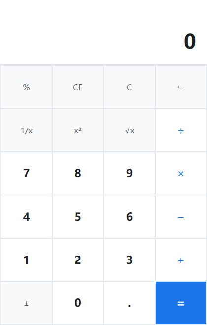
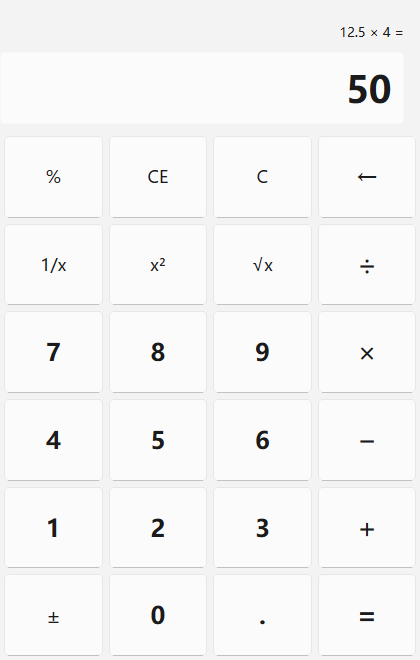
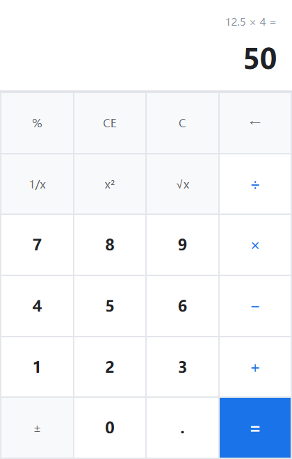
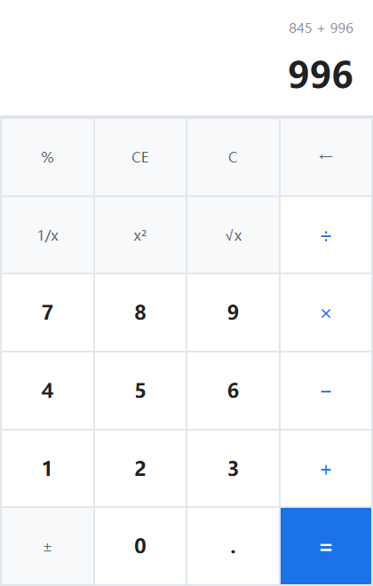
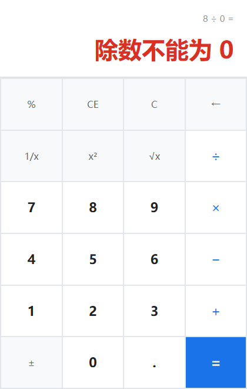

# 实验 1：带键盘事件的计算器

《Qt 应用程序开发》实验一——用 Qt 6 Widgets 实现一个同时支持鼠标点击与键盘输入的计算器。
界面用 Qt Designer（`mainwindow.ui`）搭建，计算逻辑独立成不依赖界面的状态机，
鼠标与键盘共用同一个输入分发入口，并有 QtTest 自动化测试覆盖运算与各类边界输入。



## 功能

- 四则运算（`+` `−` `×` `÷`）、小数输入、退格、清除（`C` 全部清除 / `CE` 只清当前输入）
- 上方表达式栏实时显示算式（如 `845 + 996`），等号后显示完整算式与结果
- 一元运算：`±` `%` `1/x` `x²` `√x`
- 异常输入处理：连续小数点、连续运算符、除数为 0、负数开平方、超长输入
- 边界处理：连续运算、重复按等号、结果后继续输入、错误后恢复
- 键盘输入与鼠标输入完全等价，键盘按键时对应按钮同步显示"按下"效果
- QSS 样式表美化界面，错误状态用红色提示

## 目录结构

```
.
├── calculator.pro          # qmake 工程文件
├── main.cpp                # 入口
├── mainwindow.h/.cpp/.ui   # 主窗口：界面接线与键盘事件
├── calckey.h/.cpp          # 按键语义（Calc::Key）与鼠标/键盘的统一翻译
├── calculatorengine.h/.cpp # 计算核心状态机（不依赖任何控件）
├── resources.qrc           # 资源
├── styles/app.qss          # QSS 样式表
├── tests/                  # QtTest 自动化测试
│   ├── tests.pro
│   └── tst_calculator.cpp
├── docs/
│   ├── dev-log.md          # 开发与测试记录（缺陷发现与修复过程）
│   └── screenshots/        # 运行截图
├── build.bat / run.bat     # 一键编译 / 运行
└── README.md
```

## 设计要点

### 1. 界面：Designer 布局 + 动态属性

显示区是 `QVBoxLayout` 里的"表达式 QLabel + 只读 QLineEdit"；
键盘区是 6 行 × 4 列的 `QGridLayout`，每行每列各占 1 份均分系数（由代码补足，
Designer 无法直接设置 QGridLayout 的均分系数）。

24 个按键在属性栏里统一加了两个动态属性，后续的逻辑与样式表都靠它们驱动：

| 属性 | 作用 | 例 |
| --- | --- | --- |
| `calcKey` | 按键含义（与 `Calc::Key` 一一对应） | `digit7`、`add`、`equals` |
| `buttonRole` | 样式分类 | `digit`、`operator`、`function`、`equals` |

于是接线不需要 24 条 `connect`：

```cpp
const QList<QPushButton *> buttons = findChildren<QPushButton *>();
for (QPushButton *button : buttons) {
    Calc::Key key{};
    const QString token = button->property("calcKey").toString();
    if (token.isEmpty() || !Calc::keyFromToken(token, &key))
        continue;   // 没有声明 calcKey 的普通按钮不参与计算
    connect(button, &QPushButton::clicked, this, [this, key] { dispatchKey(key); });
    m_buttonsByKey.insert(static_cast<int>(key), button);
}
```

### 2. 计算核心：显式状态机

`CalculatorEngine` 不接触任何控件，只回答"按下这个键之后显示什么"。用状态而不是若干布尔标志，
是因为同一个按键在不同阶段含义不同：

```cpp
enum class State {
    EnteringFirstOperand,   // 正在输入第一个操作数
    OperatorPending,        // 已按下运算符，等待输入第二个操作数
    EnteringSecondOperand,  // 正在输入第二个操作数
    ShowingResult,          // 正在显示计算结果
    Error                   // 错误状态（除数为 0 等）
};
```

错误状态是可恢复的：按 `C` / `CE` / 数字键都能回到正常计算，不会让程序卡死。

### 3. 鼠标与键盘复用同一套逻辑

鼠标点击与键盘按键都先翻译成 `Calc::Key`，再进入唯一的 `dispatchKey()`：

```cpp
void MainWindow::keyPressEvent(QKeyEvent *event)
{
    if (event->modifiers() & (Qt::ControlModifier | Qt::AltModifier | Qt::MetaModifier)) {
        QMainWindow::keyPressEvent(event);      // 组合键留给系统快捷键
        return;
    }
    const std::optional<Calc::Key> key = Calc::keyFromQtKey(event->key());
    if (!key.has_value()) {
        QMainWindow::keyPressEvent(event);
        return;
    }
    flashButton(*key);   // 键盘按下时让对应按钮同步"按下"
    dispatchKey(*key);   // 和鼠标点击是同一个入口
    event->accept();
}
```

两条路径只有"翻译"不同，没有任何重复的判断逻辑——测试里用同一串输入分别跑鼠标和键盘，
显示结果逐条比对一致。

### 4. 边界与异常输入

| 输入 | 处理 |
| --- | --- |
| `1..5` | 重复小数点被忽略，得 `1.5` |
| `.5` | 自动补前导 0，得 `0.5` |
| `1+×2=` | 连续运算符以最后一次为准，得 `2` |
| `1+2+3=` | 连续运算，先算出 `3` 再算 `3+3`，得 `6` |
| `8÷0=` | 进入错误状态，提示"除数不能为 0"（不让 IEEE 754 的 `inf` 流到界面） |
| `√(-1)`、`1/0` | 分别提示"负数不能开平方"、"除数不能为 0" |
| `2+3==` | 重复上一次运算，得 `8` |
| `5+=` | 缺第二个操作数时用左操作数，得 `10` |
| `2+3=` 后按 `4` | 开始新的计算，得 `4` |
| 连按 20 个数字 | 单操作数最多 16 位 |
| `0.1+0.2=` | 结果格式化，得 `0.3` 而不是 `0.30000000000000004` |

## 键盘操作

| 功能 | 键位 | 功能 | 键位 |
| --- | --- | --- | --- |
| 数字 | `0`-`9`、小键盘数字 | 等号 | `Enter`、`=` |
| 加 / 减 | `+` / `-` | 乘 / 除 | `*` 或 `x` / `/` |
| 小数点 | `.` 或 `,` | 退格 | `Backspace` |
| 全部清除 | `Esc` 或 `C` | 清除当前输入 | `Delete` 或 `E` |
| 正负号 | `N` 或 `F9` | 百分号 | `%` |
| 1/x | `P` | x² | `S` |
| √x | `R` | | |

## 编译与运行

开发环境：Qt 6.7.2 (MinGW 64bit) / GCC 13.1.0 / qmake + mingw32-make / Windows 11。

仓库带了两个批处理脚本（如 Qt 安装位置不同，改脚本里的 `QTDIR` / `MINGWDIR`）：

```bat
build.bat    :: qmake + mingw32-make
run.bat      :: 运行 build\Calculator.exe
```

手动编译：

```bash
mkdir build && cd build
qmake ../calculator.pro
mingw32-make -j8
./Calculator.exe
```

## 测试

```bash
cd tests && mkdir build && cd build
qmake ../tests.pro
mingw32-make -j8
./tst_calculator.exe -platform offscreen
```

24 个用例覆盖：四则运算、小数、重复小数点、前导小数点、退格、CE/C、除零、连续运算、
连续运算符、结果后继续输入、重复等号、一元运算、输入长度上限、数字格式化，
以及按键属性完整性、鼠标/键盘一致性（10 组序列）、鼠标键盘混合输入、编辑键位、
修饰键屏蔽、错误状态键盘恢复。

```
Totals: 24 passed, 0 failed, 1 skipped
```

需要导出报告用截图时，设置环境变量后再跑截图用例：

```bat
set CALC_SHOT_DIR=..\docs\screenshots
tst_calculator.exe visualSnapshots
```

## 界面美化前后对比

| 美化前（Qt 默认外观） | 美化后（QSS） |
| --- | --- |
|  |  |

主要改进：去掉 QLineEdit 的默认边框，显示区与键盘区分层；按键去掉立体边框，
数字加粗、运算符蓝色、等号整块高亮；键盘网格线用 2px 间距透底色实现；
错误状态文字转红；统一字号与内边距，窗口缩放时按键等比放大。

## 运行截图

| 计算过程 | 除数为 0 |
| --- | --- |
|  |  |

| 连续运算 | 退格 |
| --- | --- |
|  |  |

## 开发记录

缺陷的发现与修复过程（含测试输入、原程序现象、原因分析、修改方法）见
[docs/dev-log.md](docs/dev-log.md)。

## 注意事项

1. **构建目录不要放在含中文的路径下**。MinGW 的 `windres`、Qt 的 `moc` 在中文路径下
   容易报错；同时 qmake 的 CRT 会把命令行参数里的中文路径解析成 `???`，
   所以脚本里调用 qmake 一律使用相对路径。
2. **源码目录里不要保留旧的 `ui_mainwindow.h`**。它是 uic 的生成产物，
   残留在源码目录会因 `-I` 搜索顺序遮蔽构建目录里的新文件（已在 `.gitignore` 中忽略）。
3. 在 Qt Creator 里直接打开 `calculator.pro` 即可，测试工程是 `tests/tests.pro`。

## 关于

- 姓名：张梓鸿
- 学号：2024414300227
